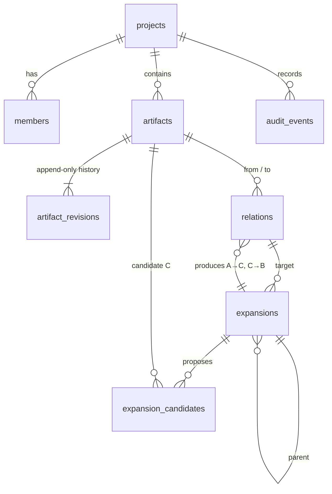

# Data model

Source of truth: `packages/store/src/schema.ts` (tables) and `packages/contracts/src`
(API projections). This page explains how they fit together.

## Invariants

| Invariant                                                                    | Enforced by                                                                 |
| ---------------------------------------------------------------------------- | --------------------------------------------------------------------------- |
| Revisions are append-only; `artifacts.head_revision_id` points at the latest | service (no update/delete paths), unique `(artifact_id, version)`           |
| Edits require the current head revision (`If-Match`)                         | conditional `UPDATE … WHERE head_revision_id = $1` → `STALE_REVISION`       |
| Locked artifacts only accept `locked: false`                                 | service → `ARTIFACT_LOCKED`                                                 |
| Relation endpoints belong to the relation's project                          | composite FKs + service → `CROSS_PROJECT_REFERENCE`                         |
| `precedes` / `derived_from` stay acyclic                                     | `assertRelationAcyclic` → `CYCLE_DETECTED`                                  |
| Expansion anchors are pinned at open time and unchanged at accept            | `left_revision_id` / `right_revision_id` → `STALE_ANCHOR_REVISION`          |
| Bridging never mutates anchors                                               | accept transaction writes only C, candidates, child relations, expansion    |
| One accept per expansion, idempotent per key                                 | row lock + unique `(project_id, accept_idempotency_key)` + fingerprint hash |
| Expansion depth ≤ `settings.maxDepth`; candidates ≤ `settings.maxCandidates` | `assertDepthWithinLimit`, service                                           |
| Bridge candidates state mechanism, assumptions, reconciliation               | `BridgeStructured` (contracts)                                              |

## Derived fields (API projections only)

- `Artifact.version` — head revision number.
- `Relation.expandedByExpansionId` — accepted expansion targeting the relation (the
  relation is then rendered as a collapsed parent edge).
- `Expansion.childRelationIds` — `[left→C, C→right]` once accepted.
- `Expansion.bridgeArtifactIds` — candidate artifacts in submission order.

## Export format

`GET /api/projects/:id/export` returns `ExportBundle` (`format: "tlon.export"`,
`version: 1`) with project, artifacts, every revision, relations, expansions and
candidates. Import validates referential integrity (`findBundleIntegrityIssues`) before
writing, preserves IDs by default and can remap them consistently (`remapIds=true`).
